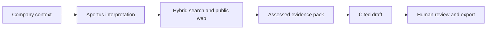

<table align="center" width="800" bgcolor="#ffffff">
  <tr>
    <td align="center">
      
    </td>
  </tr>
</table>

# B to Bern (B2B)

**From a company's research needs to a source-backed reason to explore Bern.**

B2Bern helps economic-development staff discover relevant people, research groups, projects and infrastructure across **UniBE, ARTORG and Diabetes Center Bern**.
Describe the company in ordinary language, inspect cited findings, keep the strongest reasons and export a reviewed **Why Bern?** brief.

Built for the Bern Economic Development Agency challenge at Hack Apertus.
**Team Stregoni:** Renato Mignone, Elia Innocenti, Eric Ruiz Giménez, Mohamed Kechiche.

[Judge guide](docs/judges/README.md) · [Quickstart](docs/judges/QUICKSTART.md) ·
[Architecture](docs/plans/ARCHITECTURE.md) · [Technical report](technical_report.md) ·
[Documentation](docs/README.md)

**Standalone evidence:** the [retrieval proof of concept](docs/proof-of-concept/README.md) contains a three-page PDF and real-source rankings for fictional HelioSense.
It records retrieval and traceability; newer pipeline and performance checks are linked separately.

## Why B2Bern

- **Understands intent:** Apertus v1.5 maps everyday wording to a reviewed domain vocabulary while preserving the company's full needs and constraints.
- **Searches one ecosystem:** independent PostgreSQL full-text and pgvector retrieval, RRF fusion, optional reranking and connected public web research.
- **Makes findings inspectable:** exact passages, original URLs, source status, direct/adjacent fit and explicit missing information.
- **Keeps the operator in control:** durable chat/revisions, keep/reject review and exact-hash approval before deterministic PDF or enabled PowerPoint export.



The connected development path uses **Apertus v1.5 70B through Keera**, a shared HF EmbeddingGemma 2 encoder, LangGraph/LangChain, PostgreSQL/pgvector and S3-compatible storage. React/Vite, Tailwind and Radix Themes supply the browser.

### Apertus technical report

This project uses the [Apertus v1.5 model family](https://github.com/swiss-ai/apertus). See the [official technical report repository](https://github.com/swiss-ai/apertus-tech-report), the [arXiv abstract](https://arxiv.org/abs/2610.15542), or the [arXiv PDF](https://arxiv.org/pdf/2610.15542).


## Getting started

For a scripted UI tour with no credentials:

```bash
cd src/frontend
npm ci
VITE_API_MODE=mock npm run dev -- --host 127.0.0.1
```

Requires Node 22.18+. Open Vite's local URL. The HelioSense demo is sample content; it does not run real research. PowerShell and synthetic-backend instructions are in the [quickstart](docs/judges/QUICKSTART.md).

For a provisioned connected environment, prepare dependencies and private settings using the [local runbook](docs/data/LIVE_SETUP.md), then from root:

```bash
make all       # search sidecar, API, worker and HTTP frontend in background
make destroy   # stop Make-managed services; preserve data and SSH
```

For live logs use `make docker`, `make server`, `make worker` or `make frontend`. `make help` explains prerequisites and overrides. These commands do not provision the shared database, migrate it, install dependencies or download model assets.

## Verification

Combined verification passed **310 backend tests and 57 frontend tests**, TypeScript and production build. Actual-Apertus isolated cases passed clarification, assessed reports, review and PDF export; a separate real-provider run produced a partial report on the live corpus. Shared schema `0013` retrieval measurements are recorded.
Reviewed expert Recall@10, a fresh complete case on the optimized live corpus and target deployment acceptance remain. See the [verification guide](docs/judges/VERIFICATION.md).

## Resources & Tools

Submissions use the **Apertus v1.5** family. Connected B2B explicitly selects `apertus-v1-5-70b`; alternative aliases require deliberate configuration (check [event resources](https://hackapertus.notion.site/liebefeld-resources-tools)).

| Role | Technology |
| --- | --- |
| Reasoning | Apertus v1.5 70B, CSCS through Keera |
| Encoding / reranking | Compatible EmbeddingGemma 2 vectors; optional multilingual CPU cross-encoder |
| Orchestration | LangGraph / LangChain |
| Persistence | PostgreSQL / pgvector, S3-compatible artifacts |
| Discovery / conversion | Private SearXNG, controlled HTTP, isolated Crawl4AI |
| Interface | React / TypeScript / Vite / Tailwind / Radix Themes |
| Diagnostics | Safe console events and optional self-hosted Langfuse |

## The structure

The submission template's root layout is preserved.

| Path | Purpose |
| --- | --- |
| `README.md` | Product, challenge and submission entry point |
| `technical_report.md` | Architecture, evaluation and limitations |
| `LICENSE` | Apache-2.0 code license |
| `src/` | Frontend and modular backend |
| `docs/` | Current technical guides, evaluation and original requirements/materials |
| `AGENTS.md` | Focused documentation router for agents |
| `Makefile` | Local service lifecycle |

## Environment

Backend configuration retains the required variables:

```dotenv
LLM_NAME=apertus-v1-5-70b
LLM_BASE_URL=https://gateway.keera.ch/api/v1
LLM_API_KEY=<private team key>
```

Copy [.env.example](.env.example) into an ignored private environment and provision DB/checkpoint/storage/profile/encoder access. Credentials remain backend-only.
Operators type permitted context; confidential company plans stay outside the app.
[Deployment](docs/data/DEPLOYMENT.md) distinguishes connected development from the selected, still-unverified independent air-gapped target. No cantonal internal network connection is part of the design.

## License

Code: [Apache-2.0](LICENSE). The technical report retains its CC-BY-4.0 template license. Institutional content, model weights and supplied assets keep their own rights. Partner logo/template are used only for this challenge.
[Hack Apertus terms](https://hackapertus.ch/terms-and-conditions).
