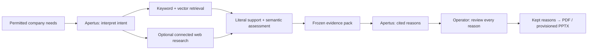

# B to Bern (B2B)

<p align="center">
  <b>From company needs to research expertise in Bern — with source-backed reasons and the operator in control.</b>
</p>

<p align="center">
  Hack Apertus Liebefeld · Bern Economic Development Agency<br>
  <b>Team Stregoni</b> · Apertus v1.5 · React · FastAPI · LangGraph · PostgreSQL + pgvector
</p>

B2B helps economic-development staff answer **“Why Bern for this company?”**
Describe a company's research needs in ordinary language, explore relevant people,
research groups, projects and infrastructure, inspect the evidence, and export a
reviewed brief.

**Start here:** [Judge guide](docs/judges/README.md) ·
[Docker setup](docs/judges/DOCKER.md) ·
[Product walkthrough](docs/judges/DEMO.md) ·
[Technical report](technical_report.md)

---

## The problem

Useful research information is spread across institute websites, team pages,
project descriptions and service directories. A company may ask for “glucose
sensors” while researchers describe continuous glucose monitoring, biosensing or
metabolic monitoring. Finding a plausible link is only the beginning: staff must
understand the fit, verify the facts and prepare a credible company-facing brief.

B2B brings those steps into one workflow. The diabetes-technology pilot connects
public information from the **University of Bern, ARTORG and Diabetes Center
Berne** as one research ecosystem.

## What B2B does

```text
Company needs → Research → Supported evidence → “Why Bern?” reasons → Operator review → Brief
```

1. **Describe the company.** Enter permitted context, needs and objectives.
   Apertus interprets the full request and asks for clarification when necessary.
2. **Find relevant capabilities.** Combine keyword and semantic search, with
   optional public web research, to find candidate evidence across institutions.
3. **Explain the match.** Assess what the passages support and distinguish direct
   matches, adjacent opportunities and missing information.
4. **Inspect and decide.** Open the original source and exact quotation, then keep
   or reject each reason. The operator remains responsible for the selection.
5. **Export the brief.** Download a reviewed PDF containing the kept reasons,
   sources and caveats. Editable PowerPoint is available when provisioned.

### Highlights

- **Every factual reason has a path to evidence.** Exact text, source URLs,
  immutable versions and claim references connect the output to its support.
- **Scientific vocabulary without losing intent.** Versioned profiles and
  semantic retrieval preserve ordinary wording, constraints and negation.
- **Evidence before writing.** Code freezes a supported evidence pack before
  Apertus drafts; valid JSON or a high similarity score cannot establish truth.
- **Review controls export.** Every reason must be reviewed and at least one kept.
  Approval binds the exact report and selections; changed content requires review.
- **Chat with revision history.** Rewrite wording from the same evidence or
  change the focus to start new research. Historical results remain read-only.
- **Honest gaps.** Missing contacts, unsupported roles, incomplete coverage and
  partial/no-match results stay visible.

## How research becomes a brief



Lexical and vector searches run independently, combine through reciprocal rank
fusion and can use a provisioned CPU reranker. Ranking finds candidates;
literal checks and semantic assessment determine support. New web evidence stays
flagged and case-local. Reports and operator edits do not automatically update
the shared corpus.

See the [architecture guide](docs/judges/ARCHITECTURE.md) and
[full execution graph](docs/plans/EXECUTION_GRAPH.md) for stage boundaries,
clarification, revisions and recovery.

## Run it

### Demo UI — no credentials

Requires **Node 22.18+** and npm. From the repository root:

```bash
cd src/frontend
npm ci
VITE_API_MODE=mock npm run dev -- --host 127.0.0.1
```

PowerShell: run `$env:VITE_API_MODE = 'mock'`, then
`npm run dev -- --host 127.0.0.1` after `npm ci`.

Open the URL Vite prints, normally **http://127.0.0.1:5173**, and choose a seeded
case. This is **scripted sample data**, not live Apertus research. Browser exports
are demo outputs. Follow the [walkthrough](docs/judges/DEMO.md).

### Connected application — Docker Compose data services

Requires **Docker with Compose v2**, **Python 3.12–3.14** and **Node 22.18+**.
On Windows use Docker Desktop's Linux/WSL2 engine. The supported layout below
runs PostgreSQL and MinIO in Compose, and API/worker/frontend on the host.

**1. Prepare the backend and a new private data stack.** Bash, from root:

```bash
python3.13 -m venv .venv
source .venv/bin/activate
python -m pip install -r src/backend/requirements.lock
python -m pip install --no-deps -e src/backend
navigator host-init
docker compose -f src/backend/deploy/compose.yaml up -d postgres minio storage-init
```

`host-init` generates ignored infrastructure credentials using the committed
image lock; it refuses to overwrite existing secrets. **These bootstrap commands
are for a new local installation.** For an existing team database, reuse its
private configuration and follow the maintainer's runbook.

**2. Initialize the new database and provision runtime access.**

```bash
navigator --env-file src/backend/deploy/.env db-migrate
navigator --env-file src/backend/deploy/.env checkpoint-setup
```

The generated host environment is for maintenance. Create a separate private
application `.env` from the root [.env.example](.env.example), with an ordinary
application identity, operator-token binding, authorized profile/corpus, matching
embedding configuration and source/export storage access. Configure Keera and
the encoder; provision tokenizer/model assets explicitly. For HF embeddings,
also install `src/backend/requirements.hosted.lock`.

A fresh database contains no usable institutional corpus or domain profile.
Follow the [Docker setup guide](docs/judges/DOCKER.md) for the full provisioning
checklist, container addresses and optional API/worker containers.

**3. Check readiness and start API and worker.** Use separate terminals in the
activated backend environment:

```bash
python -m backend.deploy.check_runtime --env-file .env
python -m backend.deploy.check_runtime --env-file .env --network
navigator-runtime --env-file .env serve --host 127.0.0.1 --port 8000
```

```bash
navigator-runtime --env-file .env worker
```

**4. Start the UI in HTTP mode.**

```bash
cd src/frontend
npm ci
VITE_API_MODE=http npm run dev -- --host 127.0.0.1
```

PowerShell: set `$env:VITE_API_MODE = 'http'` before starting Vite.
Connect using the privately provisioned **operator bearer token**. Provider keys
are backend-only. Vite proxies `/api` to localhost:8000; HTTP failures never
silently switch to sample data.

For exact PowerShell commands, a synthetic backend walkthrough, configuration
and troubleshooting, see [quickstart](docs/judges/QUICKSTART.md) and
[Docker setup](docs/judges/DOCKER.md). Startup does not download models, ingest
sources or migrate a shared database. The current runtime Compose file does not
include a frontend service.

## Architecture

- **UI:** React, TypeScript, Vite and Tailwind; case board, source inspection,
  chat, history, review and authenticated downloads.
- **API and execution:** Python, FastAPI, LangGraph/LangChain and a separate
  durable worker; authorized commands, clarification and resumable stages.
- **Storage:** PostgreSQL/pgvector for evidence, hybrid retrieval and case state;
  separate PostgreSQL checkpoints; S3-compatible artifacts.
- **AI:** Apertus v1.5 for interpretation, extraction, assessment and drafting;
  separately configured EmbeddingGemma 2 encoding and optional CPU reranking.
- **Diagnostics:** optional masked local Langfuse. Traces diagnose execution;
  they are not a fact store, and tracing outages do not block a case.

### Environment

Keep the template's model interface:

```dotenv
LLM_NAME=apertus-v1-5-70b
LLM_BASE_URL=https://gateway.keera.ch/api/v1
LLM_API_KEY=your-private-key
```

The model is selected explicitly with no automatic fallback. The complete
[environment example](.env.example) includes database, checkpoint, storage,
identity, profile and encoder settings. Keep secrets out of git and `VITE_*`.

### Target architecture

The documented primary target is **air-gapped case runtime on independent
infrastructure outside cantonal ICT**. This target is **not yet demonstrated**.
It requires packaged local inference, models/tokenizers, corpus, storage and
dependencies, with web tools and external egress disabled.

The measured development setup is connected and uses Keera/HF with member-hosted
PostgreSQL. It does not establish air-gap compliance or Swiss cloud residency.
The [technical report](technical_report.md#target-architecture-mandatory) separates
build-time and runtime dependencies and the proof still needed.

## Data and boundaries

The pilot uses public UniBE, ARTORG and Diabetes Center Berne pages and public
research PDFs. The supplied subdomain workbook supports discovery; it does not
prove exhaustive coverage. Existing snapshots or immutable live captures pin the
evidence for each run while ingestion continues.

Only **permitted company context** enters the application. Confidential company
plans and one-pagers stay outside all model inputs. Source-backed claims remain
separate from attributed operator assumptions. B2B cannot establish expert
availability, willingness to collaborate or clinical suitability.

Source copyright and model licenses remain separate from the code license.
The supplied logo and PowerPoint template are for this challenge only.

## Verification and current limits

Recorded engineering checks cover authenticated workflows, source references,
review gates, history and actual export. A real-provider run produced a partial
report and reviewed PDF. These are narrower results than comprehensive expert
discovery. The challenge's **80% expert/unit Recall@10 target is unmeasured**;
independent labels, field completeness, combined live DB/web quality and
target deployment acceptance remain work.

Run backend unit checks in the activated environment:

```bash
python -m pytest src/backend/tests -m "not integration" -q
```

Run `npm test` and `npm run build` in `src/frontend`.
Full database tests require an explicitly disposable PostgreSQL/pgvector cluster;
never use the shared deployment. See [verification](docs/judges/VERIFICATION.md)
for receipts, test scope and the distinction between synthetic checks and quality.

## Repository

- [`src/frontend/`](src/frontend/README.md) — browser UI, HTTP client and explicit
  seeded demo mode.
- [`src/backend/`](src/backend/README.md) — API, worker, ingestion, retrieval,
  model adapters, evidence and reports.
- [`src/backend/deploy/`](src/backend/deploy/README.runtime.md) — data/runtime
  Compose files, initialization, images and optional search sidecar.
- [`docs/judges/`](docs/judges/README.md) — setup, product tour, architecture,
  verification and delivery checklist.
- [`docs/`](docs/README.md) — challenge evidence, specifications, schema,
  operations and dated team handoffs.
- [`technical_report.md`](technical_report.md) — submission report draft.
- [`LICENSE`](LICENSE) — Apache-2.0 code license.

Keep `README.md`, `technical_report.md`, `LICENSE` and `src/` in their
required root locations.

## Submission requirements

This repository preserves the Hack Apertus submission layout. The local template
requires:

- A **public repository originating from the organizer template**, submitted by URL.
- A prototype that judges can run **end to end**.
- An updated `technical_report.md` and root **`Stregoni_Report.pdf`**, with a
  maximum of **six pages excluding references**.
- An accessible **demo video of at most two minutes**, with its URL in the
  report's top **Demo** field.
- Use of the **Apertus v1.5 model family** and compliance with the event terms.

**Still outstanding:** final report PDF, video URL, release integration and
verified judge access. See the [submission audit](docs/judges/SUBMISSION_AUDIT.md)
and [delivery checklist](docs/judges/DELIVERY.md). Confirm any additional
pitch/ZIP rules in the actual submission form; historical notes are not proof
of current requirements.

### Judging criteria

The template lists six dimensions, scored 0–5 each: **purposeful use of AI;
technical rigour; value, cost and scalability; sovereign deployability;
implementation feasibility; pitch and presentation**. The challenge's specific
requirements are captured in the [supplied brief](docs/challenge/CHALLENGE_BRIEF.md).

## Team

Built by **Stregoni** for Hack Apertus Liebefeld:

**Renato Mignone · Elia Innocenti · Eric Ruiz Giménez · Mohamed Kechiche**

B2B is a hackathon prototype for the Bern Economic Development Agency challenge.
It is not a production service or a guarantee of collaboration with any institution.

## Resources, license and support

- [Challenge page](https://hackapertus.notion.site/bern-economic-development-agency)
- [Event resources and tools](https://hackapertus.notion.site/liebefeld-resources-tools)
- [Apertus v1.5 8B](https://huggingface.co/swiss-ai/Apertus-v1.5-8B) and
  [70B](https://huggingface.co/swiss-ai/Apertus-v1.5-70B)
- [Hack Apertus terms and conditions](https://hackapertus.ch/terms-and-conditions)
- [Event FAQ](https://hackapertus.ch/faq)

Code: **Apache-2.0**, see [LICENSE](LICENSE). The technical-report template uses
CC-BY-4.0; third-party material keeps its own rights. For project setup issues,
record the mode, commit and safe error code without credentials. Organizer
support is available through the event Discord or **hello@hackapertus.ch**.
