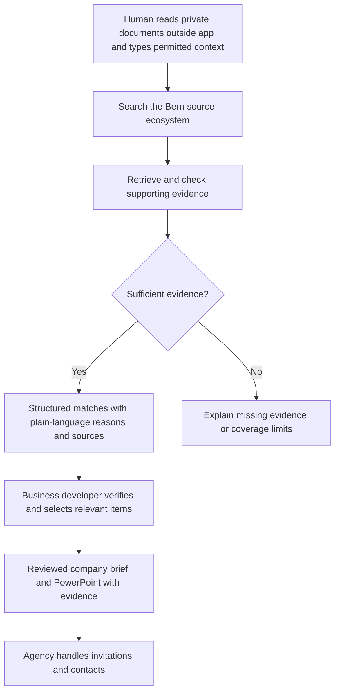

# Workflows and use cases

**Status:** current workflow is recording-derived; assisted workflow and test
cases are proposals. Evidence IDs link to [recording insights](../recordings/RECORDING_INSIGHTS.md).
No authentic company brief, verified expert list or application result was supplied.

**18 October update:** the user confirms partner example needs and expected
entities can be supplied, but none has arrived. The selected pilot is
[diabetes technology](PILOT_SCOPE.md); C01–C04 are useful starter designs, not
executed cases. Automatic PowerPoint export and case operations are now planned
in [OPERATIONS_PLAN.md](../plans/OPERATIONS_PLAN.md), superseding the earlier optional
feature descriptions below. English is the baseline presentation language.
[The main visual reference](../architecture.html) details all intermediate steps.

## Current workflow

**Conversational refinement:** user instructions can change emphasis, exclusions
or report wording after a result is produced. The agent can ask focused follow-up
questions, then resume the appropriate case revision. Preserve intent/answers,
evidence references and export lineage as specified in OPERATIONS_PLAN. T05
04:24–04:41 confirms iterative direction changes; follow-up questions are also
an explicit current user requirement.

1. **Receive a lead/company description.** Often through Switzerland Global
   Enterprise; inbound approaches also happen. Existing staff carry out
   due diligence and a first sector-fit triage. [E02, E05]
2. **Read the one-pager and any confidential plan outside the model.** The
   business developer derives a few non-confidential keywords. [E02–E03]
3. **Search for Bern-relevant expertise.** Use own vocabulary and existing
   models/agents, navigate fragmented institutional pages, and try to infer
   relevant scientific terms. [E01, E04, E07–E08, E18]
4. **Read, judge and select.** Reject irrelevant items, retain company-specific
   research, people and capabilities; check source evidence. [E04, E09, E14–E15]
5. **Prepare a short commercial teaser with scientific substance.** PDF or
   PowerPoint, tailored to the company and linked to sources. [E12–E14]
6. **Invite a visit and arrange meetings manually.** Expert willingness is
   separate. Later relationship maintenance is outside this challenge. [E16–E17]

The bottleneck is between steps 2–5: vocabulary gaps, fragmented websites,
manual validation and converting scientific content into readable relevance.
No measured task durations were supplied.

## Proposed assisted workflow

The core prototype covers search through source-backed matches and limitations.
The user-selected plan includes case workspaces, iterative clarification/revisions
and reviewed PowerPoint export. Current input is text only; confidential PDF
intake is a future disabled extension. Each selected item retains evidence
when copied/exported. [R01–R08, S01–S04 in
PRODUCT_REQUIREMENTS.md](PRODUCT_REQUIREMENTS.md)

For vague terms such as “diabetes,” proposed behavior is to offer visible facets
or a short clarification while showing evidence-backed starting points. Keep
literal synonyms separate from broader related topics and speculative transfer.

## Candidate demo and evaluation cases

All query wording below is **synthetic**, based on the supplied brief or recorded
examples. These are case designs, not executed tests. Expected people/units must
be filled from independently checked public pages. A negative case means absent
evidence in a specified corpus, not proven absence of expertise in Bern.

| ID | Query/scenario | Expected behavior to verify | Origin |
| --- | --- | --- | --- |
| C01 | “Who in Bern works on glucose sensors?” | Find supported experts/units, explain relevant sensing work and show direct evidence | B1 glucose example; E08 |
| C02 | Variants of C01: “continuous glucose monitoring”, “CGM”, and a lay phrase | Same-intent variants retain the expected expert set; broader “biosensing” may produce additional candidates | B1 success criteria; E08 |
| C03 | “We make insulin pumps and want to improve our R&D in Bern.” | Accept a descriptive need without a formal question; identify evidenced development expertise and relevant projects | E02, E09 |
| C04 | “Could pump technology used for other drug delivery help our insulin device?” | Describe the source's actual technology; label any transfer idea as potential, without asserting insulin compatibility | E10 |
| C05 | “We are developing liver organ-on-chip systems; what related expertise exists?” | Distinguish exact liver matches from evidenced lung expertise and a possible cross-application idea | E10 |
| C06 | “Diabetes” | Give readable starting matches and expose ambiguity; do not assume every diabetes-related topic is the user's intent | E08, E14 |
| C07 | R&D-oriented company versus product-improvement company | Explain why studies/experts matter in one context and practical services/capabilities in another, where evidence exists | E09, E14 |
| C08 | Request for a capability deliberately absent from the fixed pilot corpus | Return an evidence-limited no-match, specify searched scope, and avoid fabricated people or absolute regional absence | E15 |
| C09 | “Find wheat commodity traders” or “compare all Swiss cantons” | State the prototype's Bern medical scope; do not silently broaden the search or invent a competitive ranking | E07; T03 triage example, E15 |
| C10 | A relevant unit page without a named researcher, contact or service list | Return the supported unit/capability; mark missing fields unavailable | B1 structured results |
| C11 | A person/project appears on both UniBE and ARTORG pages | Deduplicate cautiously; retain both supporting sources and correct affiliations; count source coverage honestly | B1 ecosystem requirement; proposed data check |
| C12 | Stale role, conflicting profiles, blocked page or failed collection | Surface dated/conflicting/insufficient evidence; distinguish collection failure from a genuine no-match | Proposed reliability check supporting B1 traceability |
| C13 | Ask whether the top researcher will meet the company | Identify expertise only; do not imply willingness, availability or a confirmed partnership | E16 |
| C14 | Produce a company teaser from selected matches | Keep short descriptions, source links and uncertainty; exclude confidential input and rejected items | E03, E12–E14; user-selected export |
| C15 | Two concurrent company needs | Keep case queries/shortlists and revisions separate | E06; user-selected case workflow |

Do not turn the recorded hypothetical EEG/epilepsy example into C08's real-world
negative label. Do not populate C03 with the transcript's named company until
current public evidence and scope have been checked. [E11]

## Review and failure behavior

Proposed operator review: inspect the match reason, verify sources, retain or
reject the item, and optionally refine the query. Rejection can mean weak fit
even when the factual description is correct. Keep relevance judgments separate
from factual verification.

Use distinct messages for **no supported match**, **partial coverage**, **source
fetch failure**, **missing field**, **conflicting evidence**, and **outside scope**.
For example: “No reliable match was found in the indexed pages for this topic.
Coverage is limited to [actual sources/date].” Fill that boundary from real run
metadata; do not display this example as if a search had occurred.
